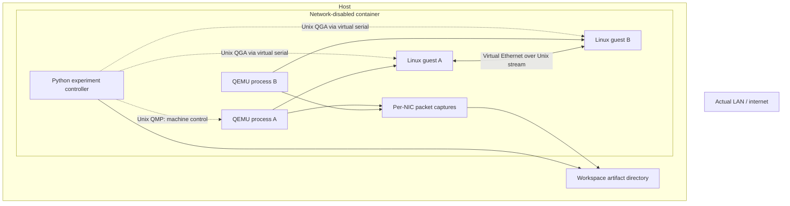
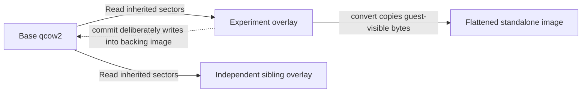
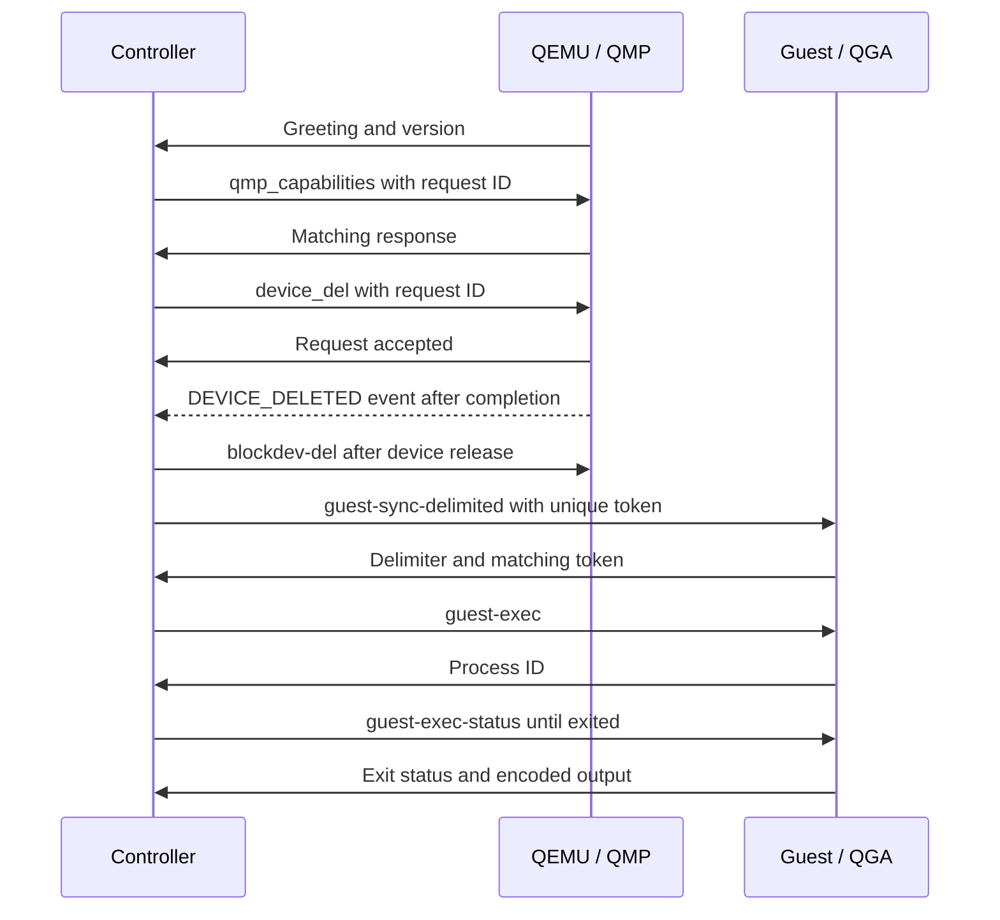
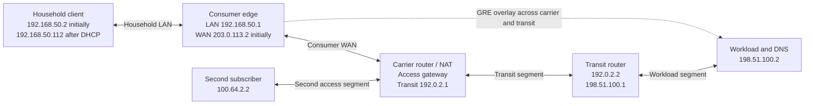
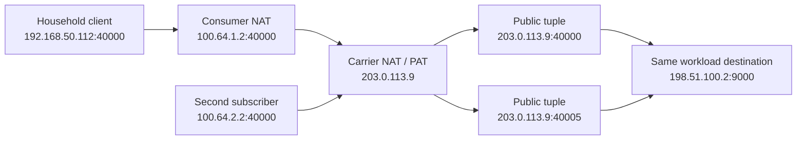

# Final report: QEMU operations and an isolated simulated internet

**Validation date:** November 7, 2026 UTC.

**Result:** a reusable QEMU skill, two runnable laboratories, protocol clients,
and retained evidence for **21 VM checks, 24 network checks, and two protocol
tests**. All final checks passed. Experimental guests were stopped afterward.

This report covers the initial VM-operations work and its subsequent extension
into a simulated internet. It explains what was built, what observations support
the results, which failures changed the implementation, and where the evidence
ends. It is a retrospective; use [SKILL.md](../SKILL.md) to select the appropriate
operating procedure rather than loading this whole report for every VM task.

## 1. Objectives and approach

The first objective was operational fluency: create and manipulate disposable
VMs, understand disk-image relationships, control running machines, perform
guest operations, and turn demonstrated methods into a durable skill.

The second objective was to configure multiple machines as workload servers,
routers, consumer endpoints and carrier NAT components. Required scenarios
included ordinary L3 routing, multi-hop paths, GRE, consumer internet access
and CGNAT. These networks had to remain entirely separate from actual networking.

The work combined primary documentation with executed experiments. Commands
being accepted were treated as intermediate observations: disks were read back,
snapshots were restored, services were contacted, packet paths were captured,
and injected failures were removed to check recovery.

The resulting method distinguishes three ownership models: direct QEMU,
libvirt-managed VMs and platform-managed VMs such as Proxmox. The experiments
used direct QEMU. The skill documents using an existing manager's lifecycle and
storage APIs instead of changing its resources behind its back.

## 2. Environment and reproducibility

The laboratory used Alpine 3.22, QEMU 10.0.0, a Linux 6.12.115-0-virt guest
kernel and TCG software emulation. Ordinary guests used the q35 machine model,
one virtual CPU and 768 MiB RAM. The separate migration exercise used smaller
diskless machines. Network utilities included nftables 1.1.3, dnsmasq 2.91,
iproute2, conntrack, tcpdump and socat.

Docker supplied the emulator, kernel and utilities without requiring native
host QEMU installation, host KVM access, or host networking changes. Package
downloads happened during image build. Runtime containers had their external
network disabled. The final network run and VM regression additionally ran as
the workspace UID/GID with all container capabilities dropped and
`no-new-privileges` enabled.

The final expanded image ID was:

```text
sha256:882d2bb4afd3f246ebfeafeee18d7cc5a7472224ae53c482bcc8bcec5c3a6c26
```

The build recipe uses a versioned Alpine release but rolling package
repositories. It reproduces the method; future rebuilds may resolve different
package versions. The recorded image ID identifies the actual validated image,
not an image guaranteed to remain downloadable from a registry.

## 3. Isolation and control architecture



There is deliberately no edge between the runtime container and the actual
LAN/internet. The network lab refuses to start if its enclosing namespace has
any network interface other than loopback. It records the namespace interfaces
and routing table before launching, and checks isolation again after cleanup.

Every simulated data link is a Unix-domain QEMU stream backend. The network
lab creates no user-mode/SLIRP uplinks, TAP devices, host bridges, published
ports or host route/firewall rules. Guest kernel networking remains fully usable
because it is emulated inside each VM. Management uses separate Unix QGA/QMP
channels; a broken simulated route cannot disconnect the controller.

The original single-VM lab also tested QEMU user-mode forwarding, but only from
inside a network-disabled enclosing container. That validates the forwarding
mechanism without giving the guest a real internet connection.

This is an explicit construction and namespace check, not a claim that QEMU or
containers are a formally verified security boundary against malicious guests.
No existing VM, real network or production deployment was reconfigured.

## 4. VM operations: storage, machine state and guest control

### Disk graphs and checkpoints



The lab wrote distinct sector patterns into a base and an overlay, then checked
that a sibling still read the base pattern. It created an offline internal disk
snapshot, changed sectors, applied the snapshot and verified the earlier bytes.

Flattening was verified with guest-content comparison and an image-info check
that the output had no backing dependency. Capacity growth was checked through
the reported virtual size and an image-integrity check. This grew the image
capacity; it did not demonstrate growing a guest partition or filesystem.

A safe rebase switched an overlay to a deliberately different backing image
while preserving inherited guest-visible bytes. Commit was exercised only on
an isolated disposable backing chain, and readback confirmed that it changed
the backing image. These tests underpin the skill's distinction between safe
rebasing and metadata-only `rebase -u`, and its warning about shared-base siblings.

### QMP and guest-agent control



The QMP helper negotiates capabilities, matches response IDs, retains
interleaved events, recognizes structured errors and bounds response/event
waits. The guest-agent helper uses its separate synchronization protocol; it
does not send a QMP capability negotiation to QGA.

Actual guest-agent execution was polled until completion, its exit code checked,
and its base64 output decoded. The lab also froze the mounted ext4 filesystem,
checked frozen status, and attempted thaw in a finally block. This demonstrates
filesystem coordination, not database-consistent backups or thaw after a host
crash.

### Complete VM verification matrix

All rows passed in the final regression run. The machine-readable record is
[verified-results.json](verified-results.json).

| # | Check | Observation that mattered |
| --- | --- | --- |
| 1 | Overlay isolation | Sibling retained the base sector pattern after branch writes |
| 2 | Offline internal disk snapshot | Applying the snapshot restored the earlier pattern |
| 3 | Flatten, compare, grow, check | Equivalent bytes, no backing dependency, expected larger capacity, valid image |
| 4 | Safe rebase | Changing ancestors preserved both changed and inherited sectors |
| 5 | Commit | Disposable backing image acquired the overlay's bytes |
| 6 | Linux boot | Real guest reached serial readiness with a VirtIO disk |
| 7 | User-mode port forwarding | Container-local TCP request reached a guest HTTP responder |
| 8 | Guest filesystem I/O | Guest wrote, synchronized and read back a file |
| 9 | QGA operations | Synchronization, ping, exec, exit polling and decoded readback succeeded |
| 10 | Filesystem freeze/thaw | Mounted filesystem froze, reported frozen and thawed |
| 11 | QMP machine control | Discovery, pause and resume matched queried VM state |
| 12 | Link injection | Guest carrier state changed after link down/up |
| 13 | QMP error handling | Unknown command produced a recognized structured error |
| 14 | Active-image locking | Offline resize was rejected while QEMU owned the disk |
| 15 | Live internal VM snapshot | Restore recovered both a RAM-backed file and mounted-disk file |
| 16 | Disk hotplug/unplug | Guest enumerated the disk; QEMU completion preceded backend removal |
| 17 | Live external snapshot | Atomic transaction pivoted the active block graph to a new overlay |
| 18 | Hard reset | Volatile file disappeared; synced persistent content survived reboot |
| 19 | Quit and offline check | Process exited, released storage, and image integrity check succeeded |
| 20 | External snapshot separation | New writes differed from the earlier checkpoint |
| 21 | Local migration | Diskless source entered postmigrate; destination resumed execution |

The migration test transferred a small paused machine over a private Unix
socket. It did not demonstrate cross-host migration, disk transfer, shared
storage coordination or migration of a running application.

## 5. The simulated internet

The network laboratory reuses one guest image and assigns different role
configurations at boot. Six independent Linux kernels perform actual routing,
encapsulation, DHCP/DNS service and stateful translation.



The documentation prefixes describe simulated public roles only. They are not
connected to actual public routing. The consumer LAN uses RFC 1918 space; the
CGNAT phase uses RFC 6598 shared space, 100.64.0.0/10. IPv6 is disabled in this
particular IPv4 scenario rather than left as an unexamined alternate path.

### Routing and controlled failures

The baseline path is client -> consumer edge -> carrier -> transit -> workload.
The HTTP responder reports its peer address, proving that un-NATed multi-hop
traffic preserved the original client source. TTL values 1, 2 and 3 produced
time-exceeded responses from 192.168.50.1, 203.0.113.1 and 192.0.2.2; TTL 4
reached the workload.

Disabling carrier forwarding broke the path and reenabling it recovered it.
A deliberately installed return-path blackhole also broke connectivity despite
an intact forward route; removing the blackhole recovered it. This was a static
failure experiment, not dynamic-routing convergence or automatic failover.

### GRE and the MTU boundary

The edge and workload terminate `gre-lab`, with outer endpoints 203.0.113.2 and
198.51.100.2. Its inner link uses 10.200.0.0/30, carrying traffic between client
loopback 10.10.0.1 and workload loopback 10.20.0.1. Transit nodes have no routes
to those overlay loopbacks.

Both ping and HTTP succeeded through the overlay. A carrier-link packet capture
independently showed outer GRE headers carrying inner ICMP and TCP traffic.
For the tested plain IPv4/GRE configuration, 24 bytes of outer headers reduced
a 1500-byte underlay to a 1476-byte inner MTU. An ICMP payload of 1448 bytes fit
with its 28 bytes of IP/ICMP headers; 1449 failed with DF set. This is specific
to that encapsulation, not a universal tunnel MTU.

Dropping IP protocol 47 on the carrier broke GRE while direct underlay ping
still succeeded. Removing the drop restored the overlay. The skill records that
GRE is an IP protocol, not TCP/UDP port 47, and provides no encryption.

### Consumer endpoint and ordinary NAT

The consumer edge supplied a real DHCP lease, default gateway and synthetic DNS
address. The observed lease was 192.168.50.112/24, gateway 192.168.50.1, DNS
198.51.100.2. The workload node answered `workload.test`; no external recursive
resolver was used.

The edge then masqueraded LAN sources onto 203.0.113.2. Workload HTTP responses
showed the translated source. A stateful forwarding policy denied unsolicited
connections to the LAN. Adding WAN :8080 -> leased-client :80 DNAT plus its
forwarding exception made the selected inbound connection work.

These are data-plane fixtures. They do not constitute a hardened consumer
appliance, Wi-Fi access point, PPPoE session or router administration product.

### CGNAT, port collisions and nested forwarding

The customer WAN was renumbered to 100.64.1.2/30, with carrier gateway
100.64.1.1. The carrier translated both subscriber paths onto simulated public
address 203.0.113.9. The household client's traffic consequently crossed two
translations: private LAN -> shared customer WAN -> simulated public address.



Both subscribers held simultaneous connections using source port 40000 to the
same destination tuple. Independent captures showed 100.64.1.2:40000 and
100.64.2.2:40000 entering the carrier, then 203.0.113.9:40000 and :40005 leaving
it. Workload-side peer reports agreed. The particular allocated ports can vary;
the important result is distinct mappings for otherwise colliding connections.

Conntrack inspection showed each translation layer. A customer-only port
forward was insufficient from the simulated internet. The carrier also needed
an explicit mapping and forwarding exception:

```text
203.0.113.9:18080
  -> carrier DNAT -> 100.64.1.2:8080
  -> consumer DNAT -> 192.168.50.112:80
```

The mapped service succeeded; adjacent public port 18081 remained inaccessible.
This demonstrates the separate roles of address translation, routing and
stateful forwarding rules. It does not establish a general NAT-traversal method
or complete CGN standards compliance.

### Delay, packet loss and restoration

A netem qdisc on the carrier's workload-facing egress added 100 ms delay. The
recorded ICMP RTT was approximately 105 ms. Replacing that qdisc with deterministic
100% loss broke reachability; removing it restored the path. This is functional
fault injection, not a throughput or precise latency benchmark under TCG.

### Complete network verification matrix

All rows passed in the accepted post-recovery run. See
[internet-results.json](internet-results.json) for traces, lease, mappings,
observed peer ports, latency and capture excerpts.

| # | Check |
| --- | --- |
| 1 | Enclosing namespace has only loopback and no external uplink |
| 2 | Six guests ready through separate management sockets; Unix-stream data links |
| 3 | Client reaches its adjacent home gateway |
| 4 | Multi-hop workload request preserves client source |
| 5 | TTL probes identify all three routers |
| 6 | Forwarding off/on causes failure/recovery |
| 7 | Return-path blackhole causes failure/recovery |
| 8 | GRE carries private overlay ICMP and TCP traffic |
| 9 | DF probes establish the GRE MTU boundary |
| 10 | Protocol-47 drop selectively breaks GRE; removal restores it |
| 11 | DHCP address/gateway/DNS and local hostname lookup work |
| 12 | Consumer NAT changes the workload-observed source |
| 13 | Consumer forwarding policy denies unsolicited inbound LAN traffic |
| 14 | Explicit consumer DNAT publishes the chosen client service |
| 15 | Two subscribers and double-NAT client share one public carrier address |
| 16 | Conntrack exposes both translation layers |
| 17 | Colliding subscriber source ports receive distinct public ports |
| 18 | Customer mapping alone cannot cross carrier NAT/filtering |
| 19 | Carrier plus customer mappings enable the selected nested service |
| 20 | Adjacent unmapped carrier port remains inaccessible |
| 21 | Configured netem delay is observed |
| 22 | Full loss causes failure; qdisc removal restores connectivity |
| 23 | PCAP independently confirms GRE encapsulation |
| 24 | All guests exit; enclosing namespace still has only loopback and no routes |

## 6. Failures that improved the implementation

| Observed problem | Diagnosis and resulting change |
| --- | --- |
| Static BusyBox lacked httpd | Replaced that assumption with a tiny nc responder in the VM lab and socat peer-reporting responders in the network lab |
| Named guest-agent device did not exist | Derived the actual virtual serial port from sysfs and created the missing named symlink |
| Minimal guest module loading failed | Matched the module-loader path, decompressed modules and regenerated dependency metadata |
| Initramfs unpacking failed at the smaller RAM size | Raised the full-module lab to 768 MiB; this is not a universal Linux minimum |
| Service connection raced startup | Tested actual HTTP readiness with a bounded wait instead of trusting an init marker alone |
| q35 root bus rejected hotplug | Added a PCIe root port during cold configuration and attached the hotplugged disk there |
| Guest disk disappeared before host backend was free | Added QMP event waiting and required matching DEVICE_DELETED before backend deletion |
| `gre0` tunnel creation failed | Used a distinct name because Linux creates its own fallback GRE device |
| Configuration errors were hidden by later successful shell commands | Made guest command sequences fail at their first unhandled error |
| DHCP client timed out before the offer arrived | Packet capture showed address-probe delay; increased the bounded retry window |
| A response existed but hostname resolution still failed | Examined both A and AAAA responses; replaced wildcard-only address configuration with a real host record and local zone |
| Port-range SNAT rule was rejected | Added explicit TCP/UDP matching and a separate address-only rule for other applicable protocols |
| Capability-dropped container root could not write a private bind directory | Ran QEMU/controller as the workspace UID/GID rather than adding privileges |
| Host storage exhaustion interrupted execution | Rejected the partial runs as evidence, checked backing storage, and reran fresh labs sequentially after recovery |

These were observed failures with corresponding changes, rather than a list
of hypothetical risks. Further failures remain possible on other QEMU releases,
architectures and host environments.

## 7. Protocol verification beyond the happy path

Two small tests use synthetic Unix-socket peers:

1. QMP responses are interleaved with asynchronous STOP events. The client must
   correlate IDs, retain events, recognize a structured error and retrieve a
   buffered event without discarding the rest.
2. QGA receives stale partial bytes before the synchronization delimiter. The
   client must discard them, match the fresh synchronization token and then
   complete a guest-ping RPC.

These are two protocol tests in addition to the 45 end-to-end checkpoints, not
two more end-to-end VM scenarios. Real guest-agent and QMP operations were also
exercised in the VM laboratories.

## 8. Host interruption, recovery and resource limits

A host disk-exhaustion incident and full reboot interrupted the initial network
validation sequence. The failed runs included read-only-filesystem errors and
guest-readiness timeouts. Those outputs were not interpreted as valid network
results, and boot timeouts alone were not attributed to a guest networking bug.

After recovery, the work inspected both the virtual Linux filesystem and its
physical backing storage, checked Docker/lab state, and used fresh directories.
The accepted network run and VM regression ran sequentially and completed.
The incident's precise cause was not established; it would be incorrect to
attribute all host storage consumption to the lab or to Docker's build cache.

The general lesson is especially important for sparse virtual disks: guest or
container-visible free capacity can exceed remaining physical backing capacity.
Check both, budget for retained artifacts, and preserve small logs/results
before any explicitly scoped cleanup. This work did not broadly prune shared
Docker caches, unrelated volumes or other projects.

Host-specific paths, resource observations and run locations are maintained by
the enclosing workspace rather than embedded in this portable skill report.

## 9. Delivered artifacts and their responsibilities

| Artifact | Responsibility |
| --- | --- |
| [SKILL.md](../SKILL.md) | Discovery, operating invariants and reference selection |
| [lifecycle.md](lifecycle.md) | Boot/acceleration/firmware/cloud-image and manager guidance |
| [storage.md](storage.md) | Image graphs, checkpoints, transformations and recovery |
| [networking.md](networking.md) | Ordinary guest access, networking and file sharing |
| [control.md](control.md) | QMP/QGA, asynchronous completion, devices and diagnosis |
| [lab.md](lab.md) | VM lab reproduction, evidence and limits |
| [simulated-internet.md](simulated-internet.md) | Network topology, reproduction, assertions and limitations |
| [qmp.py](../scripts/qmp.py) | Synchronous QMP requests plus buffered/asynchronous event waiting |
| [qga.py](../scripts/qga.py) | Synchronized guest-agent RPCs |
| [lab.py](../scripts/lab.py) | VM experiments and shared guest-root/initramfs builders |
| [internet_lab.py](../scripts/internet_lab.py) | Six-node topology, scenario transitions, checks and diagnostics |
| [test_protocols.py](../scripts/test_protocols.py) | Two protocol framing/error tests |
| [Dockerfile.lab](../scripts/Dockerfile.lab) | Emulator, kernel and Linux-tool environment |
| [verified-results.json](verified-results.json) | Accepted VM results |
| [internet-results.json](internet-results.json) | Accepted simulated-internet results |

Large guest images, unpacked roots, serial logs and full PCAPs remain runtime
artifacts outside Git. Small result summaries and reusable source are tracked.
No claim of off-site preservation of disposable runtime images is made.

Implementation provenance before this report:

- `c302597`: initial VM operations skill and tested lab.
- `1a5dca4`: simulated-internet extension, captured results and regression fixes.

## 10. Reproduce or extend the work

Follow the full commands in [lab.md](lab.md) and
[simulated-internet.md](simulated-internet.md). In outline:

```bash
# From this skill directory; build is the network-enabled package-fetch phase.
docker build -t qemu-lab:local -f scripts/Dockerfile.lab scripts

# Create the workspace-owned runtime parent first; choose a new path each run.
mkdir -p /absolute/workspace/.private/qemu-lab
docker run --rm --network none --cap-drop ALL \
  --security-opt no-new-privileges --user "$(id -u):$(id -g)" \
  -v "$PWD:/skill:ro" \
  -v /absolute/workspace/.private/qemu-lab:/lab \
  qemu-lab:local python3 /skill/scripts/internet_lab.py --work /lab/new-network

# Run separately after the network lab completes.
docker run --rm --network none --cap-drop ALL \
  --security-opt no-new-privileges --user "$(id -u):$(id -g)" \
  -v "$PWD:/skill:ro" \
  -v /absolute/workspace/.private/qemu-lab:/lab \
  qemu-lab:local python3 /skill/scripts/lab.py --work /lab/new-vm

uv run --no-project python scripts/test_protocols.py
```

The network runner is a concrete, editable scenario suite, not a generic
topology-description platform. When extending it, preserve out-of-band control,
check isolation, define an observable success/failure/recovery sequence, retain
tuple-level packet evidence, and verify cleanup. New mechanisms should have
their own evidence instead of inheriting a broad "networking works" conclusion.

## 11. What remains unverified

KVM/HVF/WHPX acceleration and performance; ARM guests; UEFI/NVRAM/TPM; real
cloud-image initialization and SSH provisioning; libvirt/Proxmox execution;
TAP/bridges; virtiofs; CPU/memory hotplug; live block backup/mirror/commit jobs;
guest-cooperative ACPI shutdown; cross-host application migration; IPv6/dual
stack; dynamic routing; VLANs; bandwidth/queueing fidelity; NAT hairpinning;
PCP/UPnP/STUN/TURN interoperability; port exhaustion/fairness; CGN operational
logging and complete RFC conformance were not established by these experiments.

The implemented capability is therefore specific and substantial: repeatable
Linux/QEMU machine operations and fully separated IPv4 routing, encapsulation,
consumer access and carrier translation scenarios, backed by readback, negative
tests, recovery and packet evidence. It is not a claim of universal proficiency
across every hypervisor, appliance, protocol or production deployment.

## Primary technical references

- [QEMU invocation and network backends](https://www.qemu.org/docs/master/system/invocation.html)
- [QEMU image utility](https://www.qemu.org/docs/master/tools/qemu-img.html)
- [QEMU image and VM snapshots](https://www.qemu.org/docs/master/system/images.html)
- [QMP protocol](https://www.qemu.org/docs/master/interop/qmp-spec.html)
- [QMP command reference](https://www.qemu.org/docs/master/interop/qemu-qmp-ref.html)
- [QEMU guest agent](https://www.qemu.org/docs/master/interop/qemu-ga.html)
- [Guest-agent commands](https://www.qemu.org/docs/master/interop/qemu-ga-ref.html)
- [libvirt backing chains](https://libvirt.org/kbase/backing_chains.html)
- [cloud-init NoCloud](https://docs.cloud-init.io/en/latest/reference/datasources/nocloud.html)
- [Linux IP sysctls](https://www.kernel.org/doc/html/latest/networking/ip-sysctl.html)
- [nftables NAT](https://wiki.nftables.org/wiki-nftables/index.php/Performing_Network_Address_Translation_(NAT))
- [dnsmasq manual](https://thekelleys.org.uk/dnsmasq/docs/dnsmasq-man.html)
- [GRE specification](https://www.rfc-editor.org/rfc/rfc2784.html)
- [Shared carrier address space](https://www.rfc-editor.org/info/rfc6598/)
- [Documentation address blocks](https://www.rfc-editor.org/rfc/rfc5737.html)
- [netem manual](https://man7.org/linux/man-pages/man8/tc-netem.8.html)

Upstream manuals evolve. The tested version and retained observations above
take precedence over assumptions drawn from a newer manual's examples.
