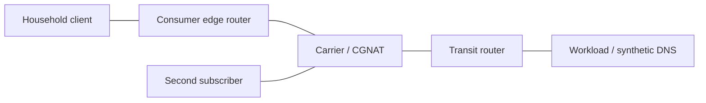

# Isolated simulated internet

Use this when the requested network is a model, not a connection to existing
infrastructure. `scripts/internet_lab.py` constructs real Linux QEMU guests
with workload and network roles and checks both successful and failed paths.
All topology setup commands run **inside the appropriate guest via QGA**.

## Isolation is part of the topology

Run the enclosing container with `--network none --cap-drop ALL` and no host
devices, published ports, host networking or privileged mode. The script checks
that the namespace has only `lo`; it refuses a normal attached Docker network.
Every guest data NIC attaches to a QEMU `stream` backend with `addr.type=unix`.
Two such endpoints form one simulated Ethernet segment. There is no SLIRP/user
network backend, TAP, bridge, physical NIC or connection to the Docker daemon.
Guest root can configure its own kernel freely; container/host root privileges
are not needed for emulated routing, nftables, GRE or netem.

Use separate private QGA/QMP Unix sockets for management, not an extra guest NIC.
Breaking all guest routing must not disconnect control. Capture each data NIC
with QEMU `filter-dump` to a local PCAP for independent packet-path evidence.
No DNS request is sent to actual resolvers: the workload node answers the
fictional `workload.test` name with dnsmasq `--no-resolv --no-hosts`.

## Topology and addressing



| Link | Left endpoint | Right endpoint |
| --- | --- | --- |
| Household LAN | client eth0: 192.168.50.2/24 initially, DHCP later | cpe eth0: 192.168.50.1/24 |
| Consumer WAN | cpe eth1: 203.0.113.2/30 | carrier eth0: 203.0.113.1/30 |
| Second subscriber | subscriber2 eth0: 100.64.2.2/30 | carrier eth1: 100.64.2.1/30 |
| Transit | carrier eth2: 192.0.2.1/30 | core eth0: 192.0.2.2/30 |
| Workload subnet | core eth1: 198.51.100.1/24 | server eth0: 198.51.100.2/24 |

In the CGNAT phase renumber the consumer WAN to cpe 100.64.1.2/30 and carrier
100.64.1.1/30. The carrier's simulated public egress address is 203.0.113.9/32
on loopback, routed by core. "Public" here describes a role only: these are
documentation prefixes, never addresses routed to the real internet. RFC 6598
100.64.0.0/10 models shared carrier address space, distinct from RFC 1918 LANs.
MACs are unique and interface order is explicit in the recorded launch argv.
IPv6 is disabled in this particular IPv4 model, not silently assumed isolated.

## Run and inspect

From the skill directory, select a fresh run directory under an existing
workspace-owned, ignored directory:

```bash
docker build -t qemu-internet:local -f scripts/Dockerfile.lab scripts
mkdir -p /absolute/workspace/.private/qemu-lab
docker run --rm --network none --cap-drop ALL \
  --security-opt no-new-privileges --user "$(id -u):$(id -g)" \
  -v "$PWD:/skill:ro" \
  -v /absolute/workspace/.private/qemu-lab:/lab \
  qemu-internet:local python3 /skill/scripts/internet_lab.py --work /lab/new-internet
```

The image build downloads generic packages. Runtime has no external network.
Check free space on both the artifact filesystem and its physical backing
storage before launching. In WSL/Docker Desktop a sparse virtual disk can
report abundant Linux free space while its Windows backing drive is full.
Run resource-heavy labs sequentially on constrained hosts, monitor backing
space and preserve small results/logs before any scoped artifact cleanup.
Do not broadly prune Docker caches, volumes or unrelated experiments as part
of this workflow. A read-only mount or host restart invalidates an interrupted
run; retain its diagnostics and use a fresh run after recovery.
Use a short container work path because Unix socket paths have a length limit.
The six guests each use one TCG vCPU and 768 MiB RAM; have capacity for roughly
4.5 GiB guest RAM plus emulator/initramfs-building overhead. The full module
initramfs is intentionally convenient rather than a minimum-footprint appliance.

Artifacts include node argv, serial logs, exact guest commands and their
status/output (`commands.jsonl`), checkpoints (`results.json`), and per-NIC
PCAPs. Guest filesystems are RAM-only. The process stops all owned guests in a
finally path on both success and failure. Preserve logs and PCAPs for diagnosis;
keep these reproducible binaries out of Git. A successful run's small summary
is retained as [internet-results.json](internet-results.json).

Validated November 7, 2026 UTC: all 24 network checks passed with QEMU 10.0.0,
Linux 6.12.115-0-virt, nftables 1.1.3, and dnsmasq 2.91 under TCG. Image ID:
`sha256:882d2bb4afd3f246ebfeafeee18d7cc5a7472224ae53c482bcc8bcec5c3a6c26`.

## Scenario progression and useful assertions

### Routed L3 baseline

Give each endpoint its adjacent gateway and routers explicit downstream routes.
Enable `net.ipv4.ip_forward` only on router-role nodes. Confirm directly connected
reachability before testing client -> CPE -> carrier -> core -> server. Workload
HTTP replies include the peer address/port, so the baseline proves source
preservation rather than merely getting a response.

Send ICMP probes with TTL 1, 2 and 3 to observe the three intermediate routers;
TTL 4 reaches the workload. Disable forwarding on carrier, then restore it.
Install a return-path blackhole on core and verify failure despite an intact
forward path; remove it and verify recovery. This catches the common mistake
of checking only outbound routes. Record `ip route get DEST from SOURCE`,
address/routes, sysctls and captures when extending a scenario.

The lab explicitly disables reverse-path filtering for its synthetic paths.
Do not infer that it should be disabled on real routers. Linux's forwarding
sysctl can reset other IPv4 parameters; inspect/reapply intended settings after
changing it. Strict RPF can reject intentional asymmetric/overlay traffic.

### GRE overlay

Build a named `gre-lab` tunnel between CPE 203.0.113.2 and server 198.51.100.2
across the two intervening routers. Use 10.200.0.0/30 on the tunnel and route
10.10.0.1/32 (client loopback) to 10.20.0.1/32 (server loopback) over it. The
transit routers have no overlay routes; packet capture must show outer GRE
headers carrying those inner addresses. Keep endpoint underlay routes outside
the tunnel to avoid recursive encapsulation.

For plain IPv4/GRE without options, a 1500-byte underlay leaves a 1476-byte
inner MTU (20-byte outer IPv4 + 4-byte GRE). DF ICMP payload 1448 fits after its
28-byte IP/ICMP headers; 1449 must fail. Options, keys, checksums, IPv6 or other
encapsulation change overhead. Drop IP protocol 47 on the carrier: ordinary
underlay IP must still work while the overlay fails. Remove the drop and
verify recovery. GRE has no TCP/UDP port 47 and does not provide encryption.
Don't assume ordinary port forwarding makes GRE work through CGNAT.

### Consumer endpoint

Start CPE DHCP on the LAN and a DNS-only responder on the workload node. DHCP
assigns a LAN address, CPE default gateway and the simulated DNS address. Test
all three plus a workload request by name. CPE uses stateful forwarding policy
and masquerades private LAN sources on its WAN. The workload must now observe
203.0.113.2 instead of the client address. Verify an unsolicited connection to
the LAN is denied. Add an explicit WAN :8080 -> leased-client :80 DNAT plus its
forwarding allow rule, and verify that selected inbound connection succeeds.

These are data-plane test fixtures, not a hardened consumer-router product:
nodes expose a small peer-reporting test service internally; appliance input
policy, admin UI, PPPoE, Wi-Fi and vendor behavior are outside this scenario.

### Carrier-grade NAT / double NAT

Renumber customer WAN into shared space, update routes and clear only the
throwaway guests' conntrack state. The CPE still translates LAN -> WAN; the
carrier translates both subscribers -> 203.0.113.9. A small explicit external
source-port range makes mappings observable. Inspect both conntrack tables;
prove that the workload observes the same public source for different
subscribers. Hold simultaneous connections to the **same destination tuple**
with the same subscriber-side source port and verify distinct external ports.

Independent capture inspection on the validated run showed both subscribers
arriving at the carrier with source port 40000 (100.64.1.2 and 100.64.2.2),
then leaving as 203.0.113.9:40000 and :40005 for 198.51.100.2:9000. Port allocation
can vary; test uniqueness and tuple correspondence, not those particular ports.

The customer's port forward alone must fail from the simulated internet. Add
carrier DNAT :18080 -> CPE :8080 and an explicit forwarding exception; only then
does the nested forward reach the client. An adjacent unmapped port must remain
inaccessible. NAT translation and the stateful forwarding policy are separate
mechanisms; don't describe private addressing alone as a firewall.

These checks demonstrate Linux NAT44/PAT and double-NAT reachability, not full
RFC 6888 conformance, endpoint-independent mapping/filtering, subscriber quotas,
logging compliance, port exhaustion, PCP/UPnP or NAT traversal interoperability.

### Impairments and cleanup

Apply `tc netem` only to the carrier guest's intended egress. Measure the added
100 ms delay, then replace it with deterministic 100% loss. Confirm failure,
remove the qdisc and confirm recovery. An egress delay is directional; symmetric
delay needs configuration in both directions. TCG is not a throughput benchmark
and scheduler noise affects precise timing. Reordering/jitter/rate scenarios
need distributions, sufficient samples and baselines, not one successful ping.

## Diagnosed pitfalls

- Linux pre-creates fallback `gre0`; creating a new tunnel under that name can
  fail. Use a distinct name and stop at the first failed configuration command.
- dnsmasq may probe an offered address before sending DHCP offers. A client's
  retry budget shorter than that probe can falsely suggest a broken segment;
  inspect the DHCP capture and use a bounded, adequate retry window.
- Container root with all capabilities removed cannot bypass a user-owned
  mode-0700 bind directory. Run the emulator as the workspace's UID/GID instead
  of adding DAC/network privileges.
- New NAT rules don't retroactively change established conntrack mappings.
  Use fresh tuples or clear only the disposable node's state between phases.
- nftables requires an explicit TCP/UDP protocol match before a NAT port-range
  mapping. Keep a separate address-only SNAT rule for ICMP/other supported
  protocols instead of trying to apply transport ports to every IP packet.
- Even an IPv4-only guest resolver can ask for both A and AAAA. dnsmasq's
  wildcard `--address` plus no upstream can refuse AAAA; adding a local zone
  alone can still return NXDOMAIN for a name that has an A answer. Use a real
  `--host-record` for the workload name so missing AAAA is NODATA, and inspect
  both DNS responses instead of assuming an A response proves lookup success.
- A blocked request is not sufficient evidence by itself: prove baseline
  reachability, apply the intended fault/rule, and demonstrate recovery.

Sources: [QEMU Unix stream backends](https://www.qemu.org/docs/master/system/invocation.html),
[Linux IPv4 sysctls](https://www.kernel.org/doc/html/latest/networking/ip-sysctl.html),
[nftables NAT](https://wiki.nftables.org/wiki-nftables/index.php/Performing_Network_Address_Translation_(NAT)),
[GRE](https://www.rfc-editor.org/rfc/rfc2784.html),
[shared space](https://www.rfc-editor.org/info/rfc6598/),
[example prefixes](https://www.rfc-editor.org/rfc/rfc5737.html),
[dnsmasq](https://thekelleys.org.uk/dnsmasq/docs/dnsmasq-man.html),
[netem](https://man7.org/linux/man-pages/man8/tc-netem.8.html).
